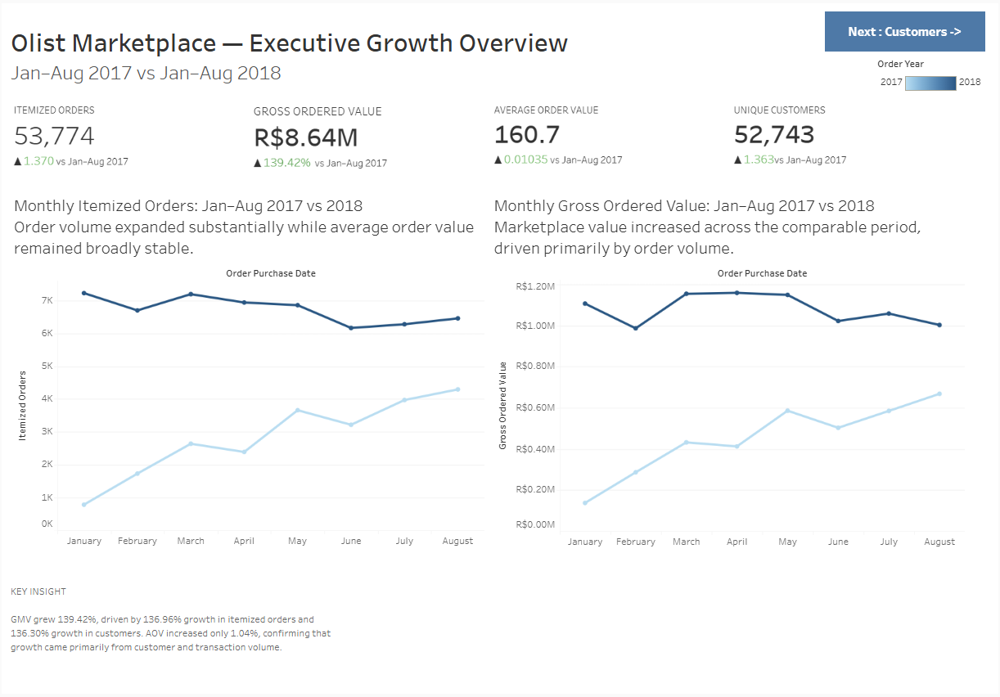
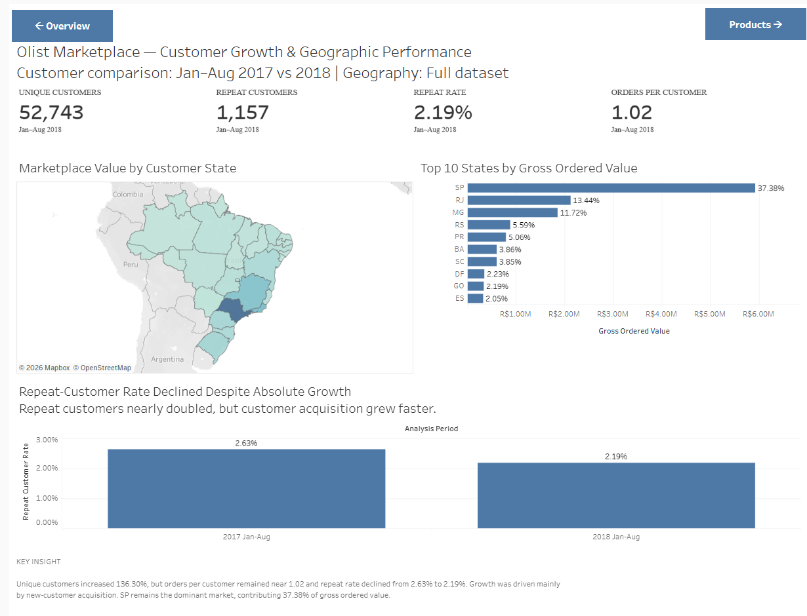
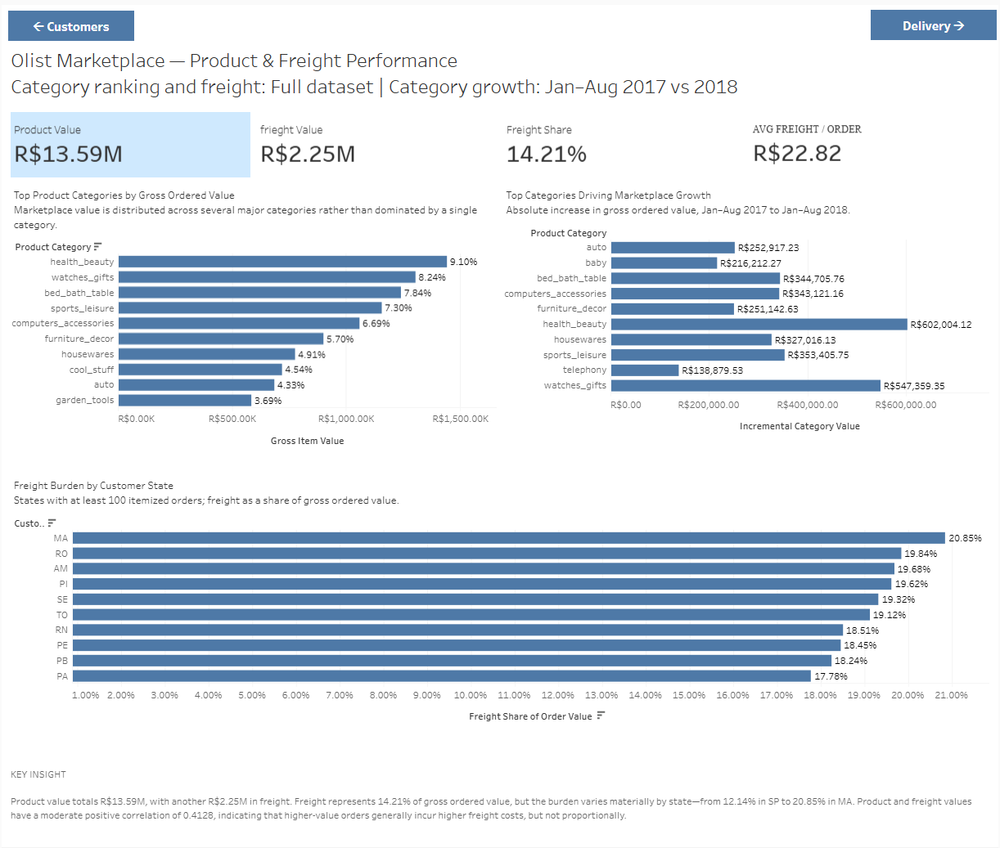
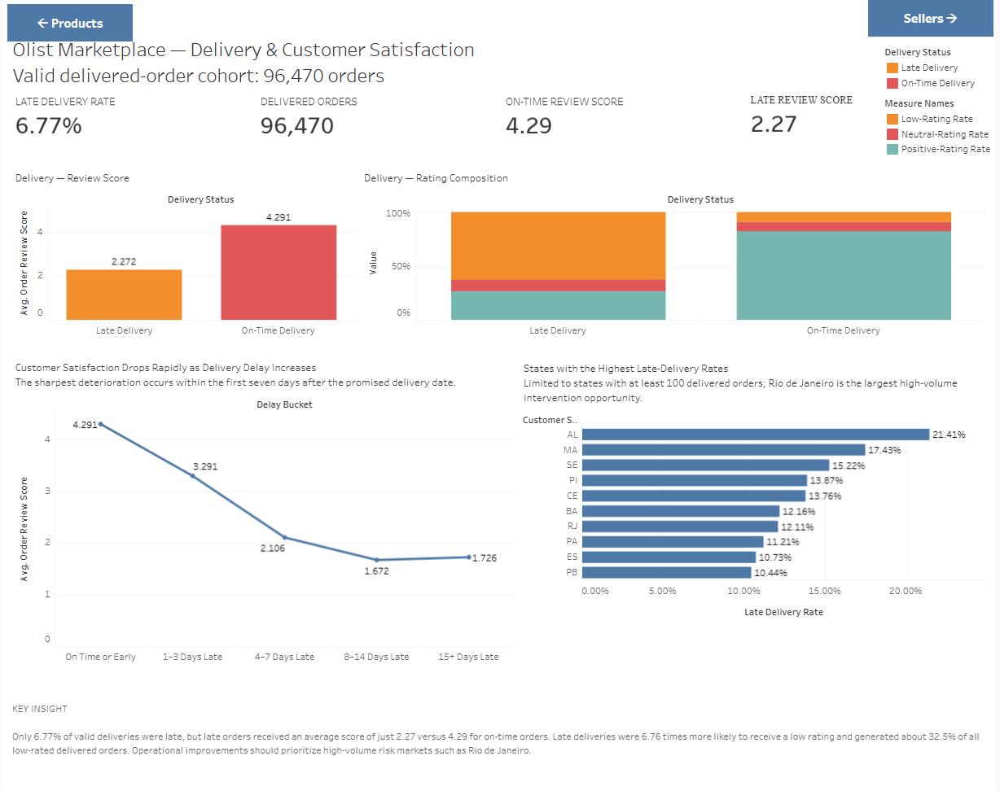
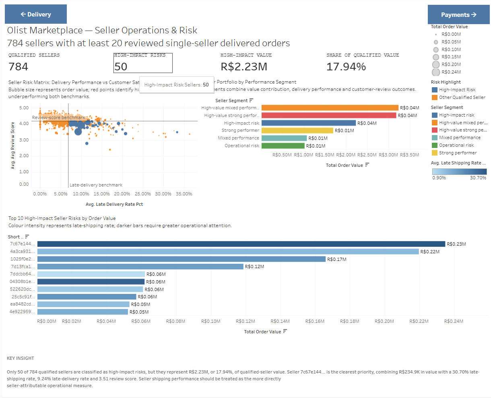
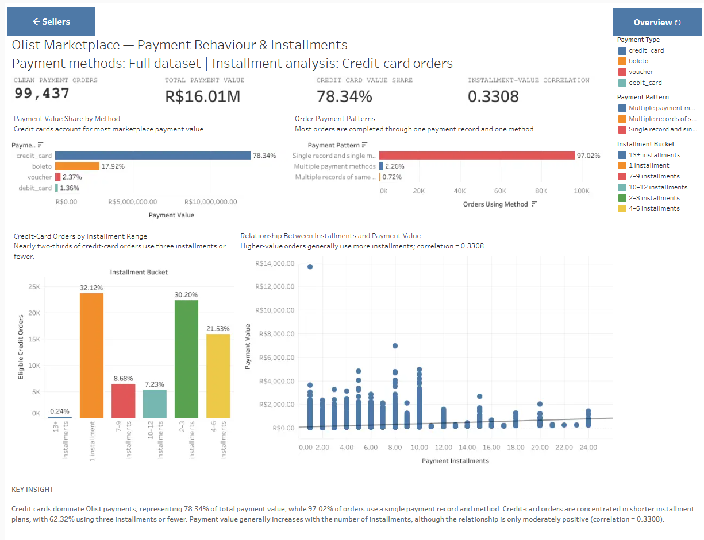

# Olist Marketplace Analytics

An end-to-end e-commerce analytics portfolio project built with **MySQL** and **Tableau Public**. The project validates the raw Olist data, builds analysis-ready fact and dimension tables, answers commercial and operational questions in SQL, and presents the results through six linked dashboards.

## Live dashboard

[View the Tableau Public profile](https://public.tableau.com/app/profile/saurabh.raushan/vizzes)

## Executive summary

- Gross ordered value increased **139.42%** from Jan–Aug 2017 to Jan–Aug 2018, while average order value increased only **1.04%**. Growth was therefore driven primarily by transaction volume.
- Unique customers increased to **52,743**, but repeat-customer rate declined from **2.63% to 2.19%**, indicating acquisition-led growth.
- Product value totals **R$13.59M**, with **R$2.25M** in freight. Freight represents **14.21%** of gross ordered value.
- Only **6.77%** of valid delivered orders were late, but their average review score was **2.27**, versus **4.29** for on-time orders.
- Among 784 qualified sellers, **50 high-impact-risk sellers** represented **17.94%** of qualified seller value.
- Credit cards represented **78.34%** of payment value. Installments and payment value had a moderate positive correlation of **0.3308** in the Tableau export.

## Dashboard suite

### 1. Executive Growth Overview



### 2. Customer Growth & Geographic Performance



### 3. Product & Freight Performance



### 4. Delivery & Customer Satisfaction



### 5. Seller Operations & Risk



### 6. Payment Behaviour & Installments



## Data model

| Table | Grain | Validated rows |
|---|---|---:|
| `fact_orders` | One row per order | 99,441 |
| `fact_order_items` | One row per order item | 112,650 |
| `fact_payments` | One row per payment sequence | 103,886 raw / 103,877 valid |
| `fact_reviews` | One row per `(review_id, order_id)` | 99,222 |

Dimensions include customers, products, and sellers. Metrics are aggregated to the required grain before facts are joined, preventing many-to-many inflation.

## Metric definitions

- **Gross ordered value:** product price plus freight; a marketplace value/GMV proxy, not accounting revenue.
- **Itemized orders:** orders with at least one order-item record.
- **Late delivery:** delivered to the customer after the estimated calendar delivery date.
- **Late shipping:** carrier handoff occurred after the item shipping-limit timestamp.
- **Repeat customer:** a `customer_unique_id` with more than one order within the selected Jan–Aug comparison window.
- **Qualified seller:** seller with at least 20 reviewed, single-seller, delivered orders.

## Repository structure

```text
olist_marketplace_analytics/
├── README.md
├── documentation/
│   ├── business_findings.md
│   └── data_quality_report.md
├── sql/
│   ├── 01_data_import_and_staging.sql
│   ├── 02_staging_validation.sql
│   ├── 03_analytics_model.sql
│   ├── 04_model_validation.sql
│   ├── 05_business_analysis.sql
│   └── 06_tableau_views.sql
└── tableau/
    └── screenshots/
```

## Tools and techniques

- MySQL 8: CTEs, conditional aggregation, window functions, date logic and grain-safe joins
- Tableau Public: calculated fields, LOD expressions, maps, KPI cards, dashboard actions and navigation
- Analytical practices: data-quality validation, cohort comparability, metric definitions and attribution safeguards

## Important limitations

- The dataset ends with an incomplete 2018 period; year-over-year comparisons therefore use Jan–Aug for both years.
- Reviews are order-level and do not identify a seller. Seller-review analysis is restricted to single-seller orders.
- Late delivery is influenced by downstream logistics; late shipping is the more directly seller-attributable measure.
- Repeat-customer rate is window-specific and should not be presented as full lifecycle retention.

